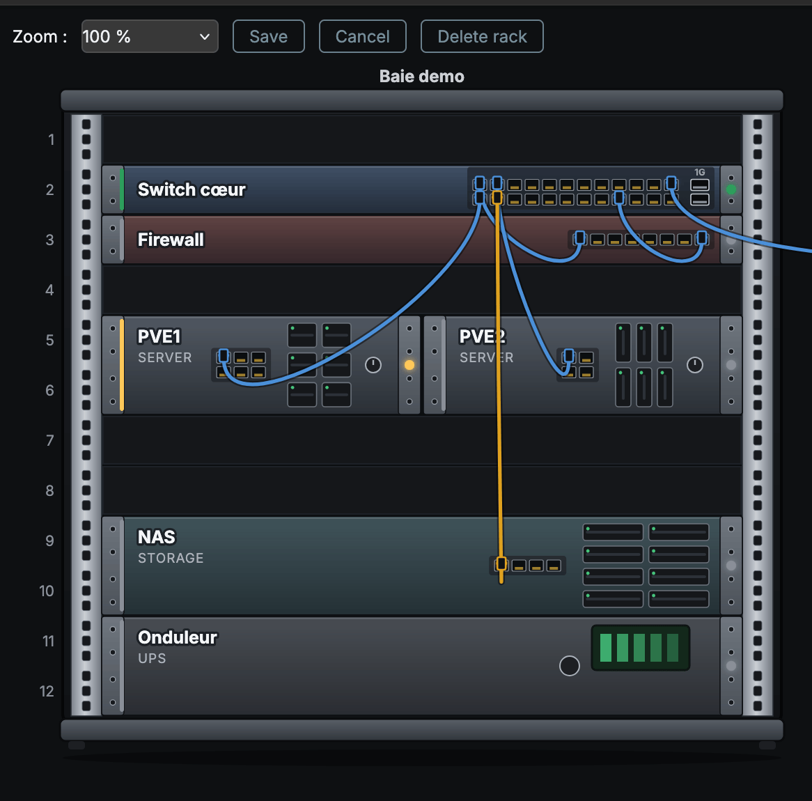

# Rackmap

🇬🇧 [English](README.md) · 🇫🇷 Français

Module frontend **Zabbix 8.0** : visualisez vos baies informatiques comme dans la réalité — équipements placés à l'U, statut en direct des hôtes Zabbix associés, câblage entre les ports et trafic animé.

## Fonctionnalités
- Baie réaliste (montants, rails, équipements 1U/2U… par type : serveur, switch, routeur, pare-feu, patch, PDU, onduleur, NAS), équipements pleine largeur ou demi-largeur.
- Faces avant détaillées : ports RJ45 et SFP (plusieurs groupes de vitesse), baies disques horizontales ou verticales.
- Numérotation des U par baie : de bas en haut ou de haut en bas.
- Vues avant et arrière, par baie : avant, arrière ou les deux côte à côte (ou l'avant d'une baie et l'arrière d'une autre). Les faces arrière montrent alimentations, ventilateurs et connecteurs ; chaque équipement a ses ports à l'avant ou à l'arrière.
- Patch panels RJ45 ou fibre (LC), port n avant relié au port n arrière ; les câbles peuvent relier un port arrière à un port avant.
- Couleur et voyant selon l'état de l'hôte associé (OK, problème par sévérité, injoignable, désactivé, passif).
- Clic sur un équipement : panneau latéral façon Cablemap (métriques, graphiques, problèmes, interfaces, liens vers Zabbix) + toutes ses connexions ; les équipements reliés ressortent, les autres s'estompent.
- Câbles partant de vrais ports ; animation selon le débit (items `net.if.in[...]` / `net.if.out[...]`), sens A→B et B→A, vitesse proportionnelle (échelle 1 Gb/s).
- Éditeur visuel intégré : ajout/déplacement (glisser-déposer à l'U), hôte associé, câbles tracés à la souris (port puis port) ou par formulaire, interface Zabbix optionnelle par extrémité.
- Plusieurs baies : datacenter par baie, choix du datacenter et des baies à afficher côte à côte, câbles entre baies.
- Zoom (ajuster à la fenêtre / 50–150 %) et export PNG.
- Tables SQL dédiées (`rackmap_*`), PostgreSQL et MySQL/MariaDB.

## Installation
1. Tables (une fois) :
   - PostgreSQL : `sudo -u postgres psql zabbix -f sql/schema.postgresql.sql`
   - MySQL/MariaDB : `mysql -u root -p zabbix < sql/schema.mysql.sql`
   - Démo facultative : `sql/demo.postgresql.sql` ou `sql/demo.mysql.sql`
   - Si le frontend utilise un autre utilisateur SQL : lui accorder SELECT/INSERT/UPDATE/DELETE sur les 3 tables (et USAGE/SELECT/UPDATE sur leurs séquences en PostgreSQL).
2. Copier le dossier dans `<frontend>/modules/rackmap` (ou `./deploy.sh`, voir l'en-tête du script : `.deploy.env` avec `ZBX_HOST`).
3. Administration → Général → Modules → Scan directory → activer « Rackmap ». Menu : Surveillance → Rackmap.

## Mise à niveau
- 0.11 → 0.12 : `sql/upgrade-0.12.postgresql.sql` ou `sql/upgrade-0.12.mysql.sql` (colonnes `port_face`, `pp_media`, `a_face`, `b_face`, vues avant/arrière).
- 0.9 → 0.10 : `sql/upgrade-0.10.postgresql.sql` ou `sql/upgrade-0.10.mysql.sql` (colonne `u_desc`, sens de numérotation des U).
- 0.7 → 0.8 / 0.8 → 0.9 : `sql/upgrade-0.8.*.sql`, `sql/upgrade-0.9.*.sql` (SFP, demi-largeur, disques).
- 0.5 → 0.6 : `sql/upgrade-0.6.postgresql.sql` ou `sql/upgrade-0.6.mysql.sql` (colonne `site`, datacenter).
- 0.3 → 0.4+ : `sql/upgrade-0.4.postgresql.sql` ou `sql/upgrade-0.4.mysql.sql` (colonnes `a_iface`/`b_iface`). Sans elles, le module fonctionne mais sans le champ « Interface ».

## Animation du trafic
Le port du câble (ex. `3`) ou le champ « Interface » est comparé aux paramètres des clés `net.if.in[...]`/`net.if.out[...]` de l'hôte lié (ex. `ifHCInOctets.3`, `eth0`). Aucun item correspondant : câble statique.

## Droits
Lecture : tout utilisateur pouvant ouvrir le module ; édition : Admin/Super admin.

## Licence
AGPL-3.0 — voir `LICENSE`.
