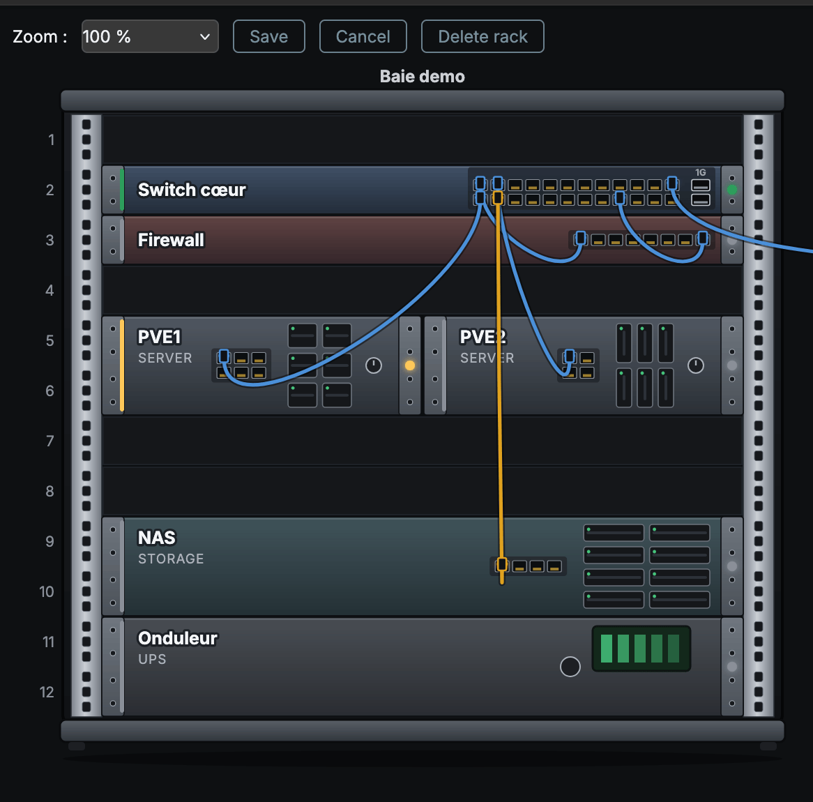
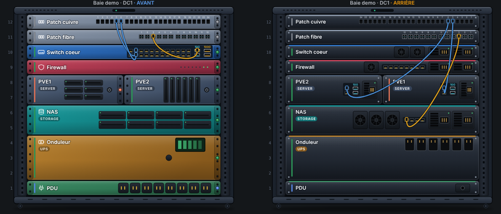

# Rackmap

🇬🇧 English · 🇫🇷 [Français](README.fr.md)

**Zabbix 8.0** frontend module: visualize your IT racks the way they look in real life — devices placed per U, live status of the linked Zabbix hosts, cabling between ports and animated traffic.

## Features
- Realistic rack with three selectable styles (cabinet, open frame, modern card); 1U/2U… devices by type: server, switch, router, firewall, patch panel, PDU, UPS, NAS, full-width or half-width.
- Detailed front faces: RJ45 and SFP ports (several speed groups), horizontal or vertical drive bays.
- Per-rack U numbering: bottom-to-top or top-to-bottom.
- Front and rear views, per rack: front, rear or both side by side (or the front of one rack and the rear of another). Rear faces show power supplies, fans and connectors, in a light, colored or dark theme; each device has its ports on the front or the rear (sensible default per type).
- Cables stay visible when one end is on a hidden face: they run through the device to the real (mirrored) port position, dashed, with an F/R badge.
- Patch panels with RJ45 or fiber (LC) ports, front port n linked to rear port n; cables can join a rear port to a front port.
- Color and LED according to the linked host status (OK, problem by severity, unreachable, disabled, passive).
- Click a device: Cablemap-style side panel (metrics, graphs, problems, interfaces, links to Zabbix) plus all its connections; connected devices stand out, the others fade.
- Cables drawn from real ports; animation based on throughput (`net.if.in[...]` / `net.if.out[...]` items), A→B and B→A directions, speed proportional to the rate (1 Gb/s scale).
- Built-in visual editor: add/move devices (drag and drop per U), linked host, cables drawn with the mouse (click a port, then another) or via a form, optional Zabbix interface per end.
- Multiple racks: datacenter per rack, choose which datacenter and racks to display side by side, cables between racks.
- Zoom (fit to window / 50–150 %) and PNG export.
- Dedicated SQL tables (`rackmap_*`), PostgreSQL and MySQL/MariaDB.

## Installation
1. Tables (once):
   - PostgreSQL: `sudo -u postgres psql zabbix -f sql/schema.postgresql.sql`
   - MySQL/MariaDB: `mysql -u root -p zabbix < sql/schema.mysql.sql`
   - Optional demo: `sql/demo.postgresql.sql` or `sql/demo.mysql.sql`
   - If the frontend uses a different SQL user: grant it SELECT/INSERT/UPDATE/DELETE on the 3 tables (and USAGE/SELECT/UPDATE on their sequences on PostgreSQL).
2. Copy the folder to `<frontend>/modules/rackmap` (or `./deploy.sh`, see the script header: `.deploy.env` with `ZBX_HOST`).
3. Administration → General → Modules → Scan directory → enable "Rackmap". Menu: Monitoring → Rackmap.

## Upgrading
- 0.12 → 0.13: no SQL change (rack styles and rear theme are stored in the browser).
- 0.11 → 0.12: `sql/upgrade-0.12.postgresql.sql` or `sql/upgrade-0.12.mysql.sql` (`port_face`, `pp_media`, `a_face`, `b_face` columns, front/rear views).
- 0.9 → 0.10: `sql/upgrade-0.10.postgresql.sql` or `sql/upgrade-0.10.mysql.sql` (`u_desc` column, U numbering direction).
- 0.7 → 0.8 / 0.8 → 0.9: `sql/upgrade-0.8.*.sql`, `sql/upgrade-0.9.*.sql` (SFP, half width, drives).
- 0.5 → 0.6: `sql/upgrade-0.6.postgresql.sql` or `sql/upgrade-0.6.mysql.sql` (`site` column, datacenter).
- 0.3 → 0.4+: `sql/upgrade-0.4.postgresql.sql` or `sql/upgrade-0.4.mysql.sql` (`a_iface`/`b_iface` columns). Without them the module still works, but without the "Interface" field.

## Traffic animation
The cable port (e.g. `3`) or the "Interface" field is matched against the parameters of the linked host's `net.if.in[...]` / `net.if.out[...]` item keys (e.g. `ifHCInOctets.3`, `eth0`). No matching item: the cable stays static.

## Permissions
Read: any user who can open the module; edit: Admin / Super admin.

## License
AGPL-3.0 — see `LICENSE`.
